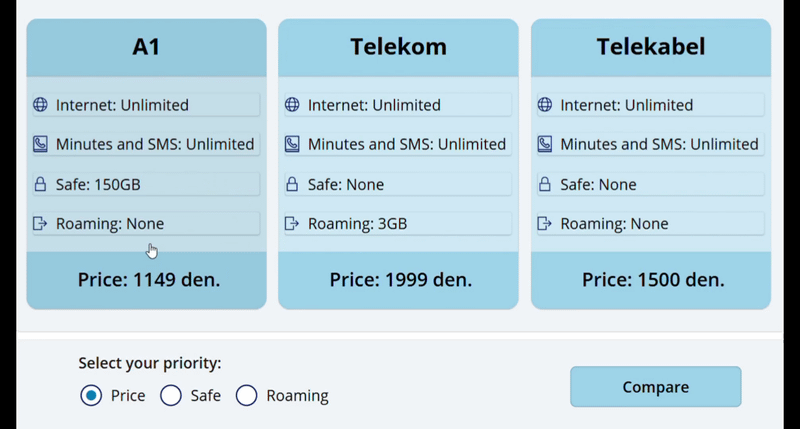
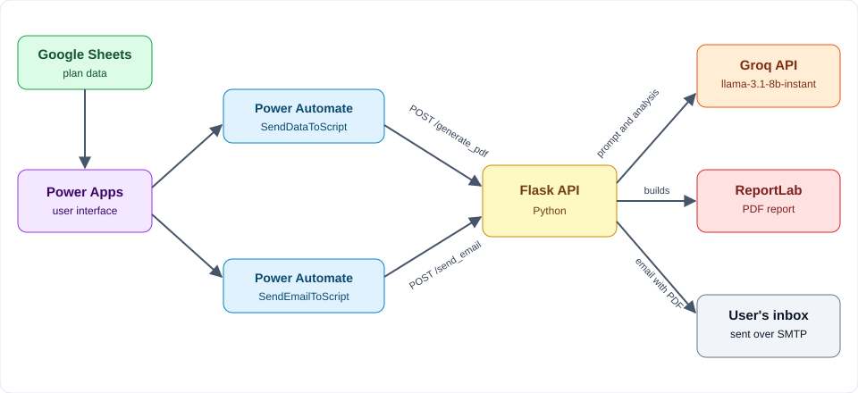
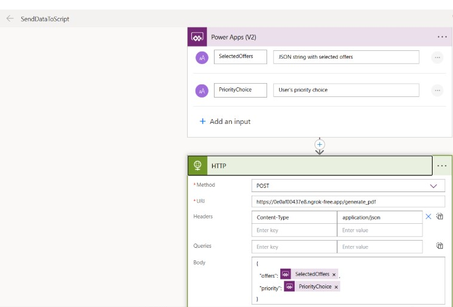
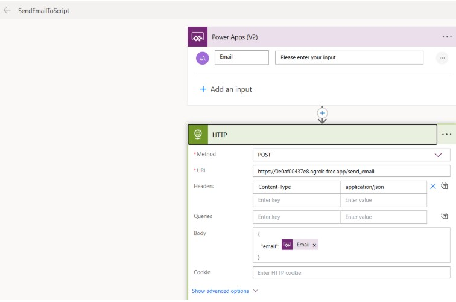

# Mobile Plan Comparison with AI
 
An app that compares mobile plans from different operators and explains, in plain language, which one fits the user's priority best. The user picks two plans and a priority (Price, Safe or Roaming), and gets a PDF report with a comparison table and an AI-written analysis, delivered to their email.
 
Built with Microsoft Power Apps, Power Automate, a Python Flask API, the Groq API (`llama-3.1-8b-instant`) and Google Sheets.
 

## What it does
 
1. The user selects two plans in the Power Apps interface and chooses a priority: **Price**, **Safe** or **Roaming**.
2. On **Compare**, Power Automate sends the selected plans and the priority to the Flask API.
3. The API builds a prompt, asks the LLM for a pros and cons analysis, and generates a PDF report.
4. The user enters an email address and the PDF is sent to their inbox.

The AI is instructed not to pick for the user. It explains the pros and cons of each plan relative to the chosen priority and ends with a one-line conclusion about which plan is better value for that priority.
 
## Architecture
 

## How the flow works
 
**1. Choosing plans.** Power Apps reads the available plans from a Google Sheet and shows them as cards. The user selects two of them and picks a priority.
 
**2. Sending the request.** When the user presses Compare, the `SendDataToScript` flow in Power Automate takes the selected plans and the priority and sends them to the Flask API with an HTTP POST request to `/generate_pdf`. Because the Flask server runs locally, ngrok is used to give it a temporary public URL that Power Automate can reach.
 

**3. AI analysis.** The API builds a prompt containing the two plans as JSON and the user's priority, together with rules for the answer: be objective, explain pros and cons instead of choosing for the user, use denars for prices, avoid markdown, and finish with a short conclusion. The prompt also explains what "Safe" means. The prompt is sent to `llama-3.1-8b-instant` through the Groq API.
 
**4. Cleaning the output.** The model's answer is post-processed before it goes into the PDF: stray markdown is removed, plan names are bolded, "Pros" and "Cons" are underlined and the conclusion is placed on its own line. This keeps the report looking the same even if the model's formatting varies.
 
**5. Building the PDF.** ReportLab generates a report with a title, a side-by-side comparison table of the two plans, and the AI analysis with its conclusion. The PDF is kept in memory.
 
**6. Sending the email.** The user types their email address in the app, and the `SendEmailToScript` flow sends it to `/send_email`. The API attaches the PDF to an email and sends it over SMTP.
 

| Component | Role |
|---|---|
| **Power Apps** | Front end where the user picks plans and a priority |
| **Google Sheets** | Stores the plan data |
| **Power Automate** | Two flows that pass data from the app to the API over HTTP |
| **Flask API** | Receives requests, calls the LLM, builds the PDF, sends the email |
| **Groq + Llama 3.1 8B Instant** | Generates the comparison text |
| **ReportLab** | Builds the PDF report |
| **ngrok** | Exposes the local Flask server so Power Automate can reach it |
 
## Data
 
The plan data is kept in Google Sheets and read by Power Apps. Each plan has a name, price, internet, minutes and SMS, Safe and roaming.
 
Prices are in denars. "Safe" is a feature that stores unused monthly internet data, up to 150GB, so it is not lost at the end of the month. The prompt explains this to the model.
 
## API
 
| Method | Endpoint | Body | Description |
|---|---|---|---|
| POST | `/generate_pdf` | `{"offers": "<JSON string of two plans>", "priority": "Price"}` | Runs the AI comparison and generates the PDF |
| POST | `/send_email` | `{"email": "user@example.com"}` | Emails the most recently generated PDF |
| GET | `/download_pdf` | none | Downloads the most recently generated PDF |
 
`offers` is sent as a JSON string because that is how Power Automate passes it, so the API parses it with `json.loads`.
 
## Design decisions
 
- **Prompt constraints.** The prompt forbids markdown and asks for plain text with Pros, Cons and a Conclusion. The API then applies its own formatting so the PDF looks consistent.
- **The model does not decide for the user.** It lays out trade-offs and gives a short conclusion for the chosen priority only.
- **Low-code front end, code back end.** Power Apps and Power Automate handle the interface and orchestration, while the logic that needs real code (LLM, PDF, email) lives in a small Flask service.
## Limitations and future improvements
 
This is a demo project, so it has limitations: it supports one user at a time, the server runs locally through ngrok, and error handling and validation are basic. It could be improved in the future by deploying the API to a hosted service, storing reports per request, adding authentication, and supporting more plans and priorities.
 
## Tech stack
 
Python, Flask, Groq API (Llama 3.1 8B Instant), ReportLab, SMTP, Microsoft Power Apps, Power Automate, Google Sheets, ngrok
